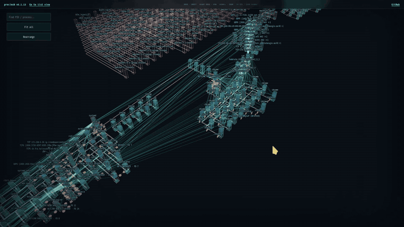
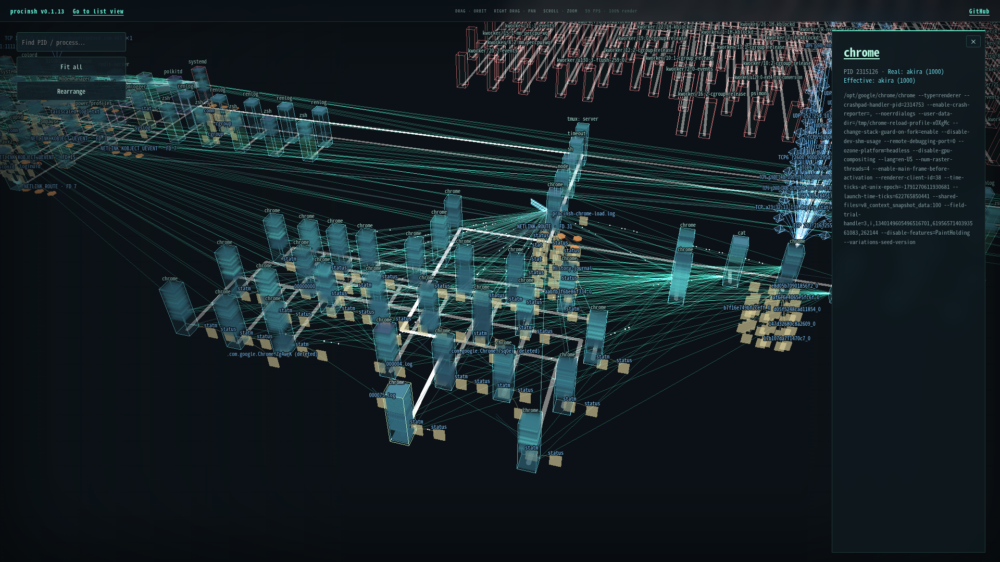
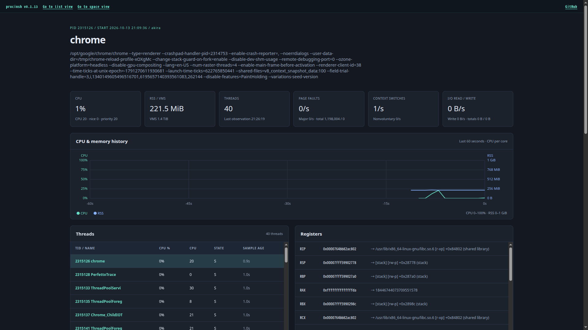
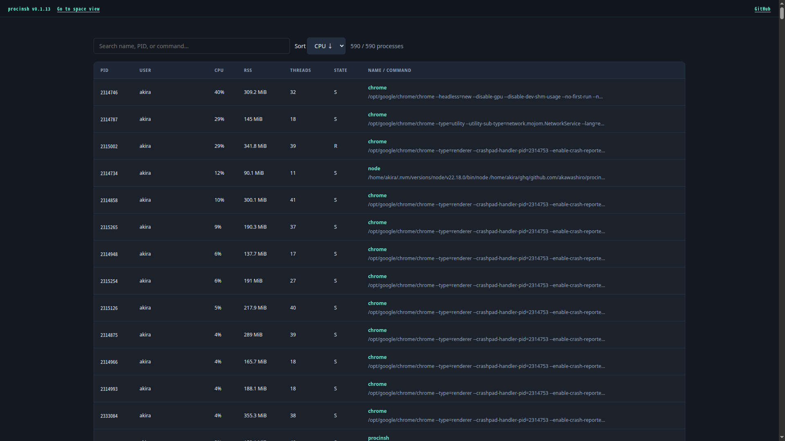

# ProcInSh - Process in the Shell

ProcInSh (pronounced "proc-in-shell") is a web-based process inspector for Linux.
Like [Ghost in the Shell](https://en.wikipedia.org/wiki/Ghost_in_the_Shell), you can wander through process space with your ghost.

See also [a blog post](https://akawashiro.com/articles/procinsh-en).

Join our [Discord server](https://discord.gg/aQuNSczpw) for questions and discussion.

## Screenshot










## Usage

Requires Linux x86-64. Both installation methods compile native code and require
Rust, a C compiler, clang with the BPF backend, bpftool, pkg-config, libelf and
zlib development files, and BTF information at `/sys/kernel/btf/vmlinux`.

Support on WSL2 is very limited, I recommend building procinsh from source rather than installing it from crates.io.

In SPACE (live or replay), **Tour Mode** moves through overview, process close-up,
and flythrough shots. Overviews and close-ups favor the systemd tree; flythroughs
visit several kthreadd descendants at a constant speed for 15 seconds after entry,
falling back to userspace processes when kernel subjects are unavailable. Each overview makes a full 360-degree orbit.
The tour includes occasional pauses and automatic
Rearrange at wide-shot boundaries. **Exit Tour**, Esc, drag, or zoom returns
camera control; search, Fit all, and Rearrange also stop the tour. Share or bookmark
`/space?tour=1` (or add `&tour=1` to a replay URL) to start touring automatically
once the scene loads. Starting or stopping the tour updates the URL. The tour
pauses while the tab is hidden and is disabled with reduced motion enabled.

### Install from crates.io

Install [procinsh from crates.io](https://crates.io/crates/procinsh) and run it:

(Sorry, we assume you are using Ubuntu, please reinterpret not so)
```sh
sudo apt-get install --yes --no-install-recommends \
         build-essential clang llvm pkg-config libelf-dev zlib1g-dev python3 \
         linux-tools-common linux-tools-generic
cargo install procinsh --locked
```

Then run and open http://127.0.0.1:9090 in your browser. To allow remote
access, use `--allow-non-loopback`, but be careful: this exposes process memory
and environment variables without any authentication.

```
sudo "$HOME/.cargo/bin/procinsh" --listen 127.0.0.1:9090
```

If you don't want to use `sudo`, please use setcap instead of it.

```
sudo setcap \
  cap_sys_ptrace,cap_bpf,cap_perfmon,cap_dac_read_search,cap_sys_admin=ep \
  "$HOME/.cargo/bin/procinsh"
"$HOME/.cargo/bin/procinsh" --listen 127.0.0.1:9090
```

`CAP_SYS_ADMIN` enables UNIX socket peer diagnostics in other network namespaces.
Without it, ProcInSh keeps available socket information and reports missing
peer diagnostics as warnings; an unknown peer does not mean an unconnected socket.

### Self build on Linux

#### Ubuntu

Also requires Node.js 22.12 or newer with npm and Rust via rustup. The Rust version
and components are pinned in `rust-toolchain.toml`; rustup installs them
automatically when needed.

Clone this repository and run the following from its root:

```sh
sudo apt-get install --yes --no-install-recommends \
         build-essential clang llvm pkg-config libelf-dev zlib1g-dev python3 \
         linux-tools-common linux-tools-generic
npm --prefix web ci
npm --prefix web run build
cargo build --release --locked
```

Then run:

```sh
sudo ./target/release/procinsh --listen 127.0.0.1:9090
```

#### NixOS

With Rust installed via rustup, create `shell.nix` in the repository root:

```nix
{ pkgs ? import <nixpkgs> { } }:
pkgs.mkShell {
  packages = with pkgs; [ nodejs_22 clang llvm pkg-config elfutils zlib bpftools gnumake ];
  hardeningDisable = [ "all" ];
}
```

Build the web assets and binary inside the Nix shell:

```sh
nix-shell --run 'npm --prefix web ci --no-audit --no-fund && npm --prefix web run build && cargo build --release --locked'
```

The binary links to libraries such as `libelf` in `/nix/store`. Create a GC root
to keep these dependencies from being removed by `nix-collect-garbage`:

```sh
nix-build shell.nix -A inputDerivation -o .nix-gcroot
```

Keep `.nix-gcroot` while using the binary. Then run:

```sh
sudo ./target/release/procinsh --listen 127.0.0.1:9090
```

### Building on WSL2 (Ubuntu)

Ubuntu's `bpftool` wrapper may fail with `bpftool not found for kernel ...`
because the WSL2 kernel version differs from the Ubuntu tools package. Set
`BPFTOOL` to the packaged executable directly, bypassing the wrapper:

```sh
sudo apt-get update
sudo apt-get install --yes --no-install-recommends \
         build-essential clang llvm pkg-config libelf-dev zlib1g-dev python3 \
         linux-tools-common linux-tools-generic
for tool in /usr/lib/linux-tools/*/bpftool; do
    if [ -x "$tool" ]; then
        export BPFTOOL="$tool"
        break
    fi
done
"${BPFTOOL:?No packaged bpftool found; install linux-tools-generic}" version
"$BPFTOOL" btf dump file /sys/kernel/btf/vmlinux format c >/tmp/procinsh-vmlinux.h
npm --prefix web ci
npm --prefix web run build
cargo build --release --locked
```

Then run:

```sh
sudo ./target/release/procinsh --listen 127.0.0.1:9090
```

_Now, where shall I go? The process space is vast._
